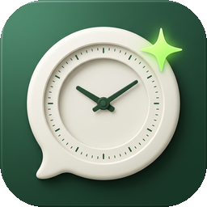

<p align="left">
  
</p>

# Okeeper · 赛博早八

> **Codex，你这个年纪怎么睡得着的？**

Okeeper 是运行在常开 Linux 服务器上的本机调度与额度管理控制台：按账号独立编排触发队列、实时监测多账号额度并自动切号，同时支持向指定 Codex 会话定时投递自定义提示词。

- **按账号独立触发队列**：每个账号拥有专属的触发时间轴队列，按最近一次触发顺序排列并自动标注跨日 `+1`，支持一键 **⚡ 对齐重置点** 与 **＋ 顺延下一轮**。
- **手动立即发送**：每个账号可立即发送一次轻量 `ok`，显示执行回执并防止重复提交；窗口起止以账号额度服务返回为准。一次闹钟被领取后立即移到队尾，每日闹钟到点后自动滚动到下一天。
- **每次选路与每日会话**：触发时按主后台实际登录账号选择主后台或该账号独立 Home；会话按账号、所在端和日期分别复用，跨天新建，发送后顺手清理登记过的旧日期触发会话。
- **实时触发次数与 Token 统计**：顶栏仪表盘统计 `6 Luna Light · ok` 累计触发次数与真实消耗 Token，每次打开页面自动回放当日累计增量动效。
- **多账号额度与自动切换**：实时查看各账号短期与每周剩余额度，支持手动切换重启主后台，或开启额度耗尽后的自动切号。
- **网页账号管理**：通过官方设备码授权添加 Codex 账号；可停用或重新启用账号。停用隐藏账号并暂停 Okeeper 的触发和自动切换，保留登录凭据与原闹钟配置。
- **到点新建会话**：定向发送中可选择已有会话，也可保存工作文件夹和新会话名称；到点后先核验或切换所选账号，再创建会话并立即发送。每天模式每次创建新会话。
- **切号后继续任务**：可选开关，默认关闭。自动切号成功后，向本次受影响的原会话发送 `continue`，沿用原模型和权限，并记录防重复回执。
- **近期请求**：账号队列标题旁的按钮打开记录窗口，按时间倒序汇总最近 100 条自动触发、手动发送、continue 和定向发送记录。显示账号、主后台 / Home 和结果，点击展开详情；窗口打开时每 5 秒刷新。continue 的提交回执显示「已提交」，历史未保存的账号标为「未记录」。
- **定向会话发送（底部独立专区）**：跨项目选择已有 Codex 会话并编写多行提示词（支持带滚动条预览）；默认沿用目标会话设置，也可实时读取 `model/list` 强制指定本次投递的模型与推理强度档位。
- **指定定向任务账号**：可跟随执行时的主后台，也可固定账号。到点发现账号不同时，先在后台空闲时切换并核验，再向原会话发送；后台忙碌或切换失败时记录跳过。
- **本机 systemd 调度**：统一台北时间（24 小时制），错过跳过、先持久化再去重投递。

## 运行

需要 Linux、用户级 systemd、Python 3.11+，以及已登录并运行的 Codex app-server。

```sh
python3 -m venv .venv
.venv/bin/pip install -r requirements.txt
.venv/bin/python app/web_server.py
```

打开 `http://127.0.0.1:18793`。安装常驻服务与本机定时器：

```sh
.venv/bin/python scripts/install_services.py --start
```

如需通过自己的私有网络地址访问，使用 `--bind <服务器私网 IP>`。账号切换会重启主 Codex 后台，并中断它正在执行的任务。

## 测试

```sh
.venv/bin/python scripts/test.py
npm ci
OKEEPER_PYTHON="$PWD/.venv/bin/python" npm test
```

浏览器测试需要本机 Chrome/Chromium，可通过 `OKEEPER_BROWSER` 指定可执行文件。测试使用虚构账号和临时任务库；截图及报告写入不入库的 `artifacts/`。

## 项目文档

[交付文档](docs/HANDOVER.md) 说明核心设计、目录、配置、部署、迁移、执行证据与故障恢复。

网页使用本地保存的 daisyUI 和 Motion；上游信息及许可证见 [web/vendor/README.md](web/vendor/README.md)。
