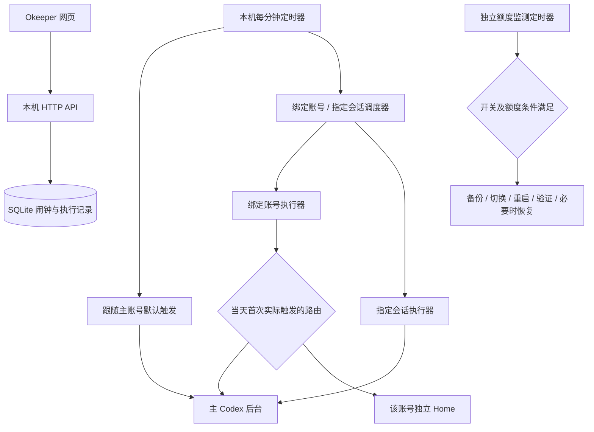

# Okeeper 交付文档

## 1. 交付目标与设计取舍

Okeeper 把“何时给 Codex 发消息”和“Codex 如何执行任务”分开。网页负责设置时间、目标与提示词；常开服务器负责按时投递和观察结果；模型实际执行仍由本机 Codex app-server 完成。

最初需求是让一次很轻的实际推理尽量贴合工作节奏，从而影响账号五小时用量窗口的起点。Okeeper 负责准时发起真实一轮处理，不把进入队列或连接成功当成执行完成。额度规则由服务提供方决定，Okeeper 不修改额度，也不能保证一次请求一定改变重置时间。

关键取舍：

1. **本机调度**：网页关闭、SSH 断开仍由用户级 systemd 触发，不使用云端计划任务。
2. **错过就跳过**：晚于约定时点 15 秒不发，不在恢复联网后集中补发。
3. **先记录再发送**：以持久化的时点与目标去重；状态不确定时不自动重发，避免额外消息。
4. **默认路径保持轻量**：固定 `gpt-6-luna`、`low`（界面 Light）、正文 `ok`；不开放模型和强度选择。
5. **自定义会话单独执行**：可填写提示词，沿用目标会话设置；长任务不会因调度器的短超时被主动停止。
6. **源码与私密运行状态分离**：GitHub 只保存实现、部署模板、文档和可复现测试。

## 2. 用户能做什么

| 区域 | 行为 |
| --- | --- |
| 标题与时钟 | 展示下一次发送，统一 Asia/Taipei、24 小时制 |
| 账号额度 | 展示完整邮箱、五小时及服务返回的其他窗口余额、重置时点 |
| 账号操作 | 手动切换账号并重启；独立的重启后台按钮 |
| 自动切换开关 | 默认关闭，开启后在五小时额度用尽且另有可用账号时切换并重启 |
| 我的时间 | 每天 / 仅下一次，新增、编辑、启停、删除、撤销删除 |
| 默认触发 | 跟随主账号或绑定具体账号；固定 Luna Light / ok |
| 指定会话 | 选择本机主后台中的已有会话，填写提示词 |
| ＋5小时01分 | 仅默认触发卡片显示，新建定时器，保留账号和重复方式 |

时间滚轮支持触屏滑动、鼠标悬停滚轮和点击输入。编辑框打开后直接按 Enter 即保存；提示词中的 Enter 换行，Ctrl / ⌘ + Enter 保存。下一次触发卡片高亮，启停时使用 Motion 缩放动画，并尊重减少动态效果设置。

## 3. 目录和运行边界

```text
Okeeper/
├── app/                    Python 服务、调度、执行与持久化
│   ├── settings.py         路径及子进程环境配置
│   ├── web_server.py       HTTP 页面和 API
│   ├── schedule_store.py   闹钟、每日/一次、＋301 分钟
│   ├── trigger.py          跟随主账号的默认触发
│   ├── custom_*.py         指定会话调度 / 状态 / 执行
│   ├── account_*.py        账号路由、额度、切换和账号触发
│   ├── auth_profiles.py    原生账号副本发现与更新
│   ├── quota_watch.py      自动切换监测
│   ├── session_catalog.py  主后台跨项目会话目录
│   └── rpc.py              Codex app-server 通信
├── web/                    HTML / CSS / JavaScript，本地 vendor
├── deploy/systemd/         可迁移的服务与定时器模板
├── scripts/                服务安装及隔离测试入口
├── tests/                  Python 回归测试
│   └── browser/            离线浏览器回归与虚构数据服务
├── docs/HANDOVER.md         本交付文档
├── requirements.txt        Python 运行依赖
├── package*.json            浏览器测试依赖，不是前端构建要求
└── README.md                项目简介及快速启动
```

前端没有构建步骤，运行时不请求 CDN。Python 直接使用标准库 HTTP 服务和 SQLite，额外运行依赖为 `websockets`。Node 和 Playwright 仅用于开发测试。

已有部署的运行状态继续保存在 `~/.local/state/codex-local-trigger`。保留这个历史目录名是为了维持账号独立 Home、会话路径和执行去重记录，不代表源码仍在旧路径。原始 Codex 登录及会话仍由 `~/.codex` 管理。

## 4. 调度与执行路径



### 4.1 默认跟随主账号

`okeeper-default.timer` 每分钟唤醒 `trigger.py daily`，仅在启用闹钟的准确分钟处理。时点键为 `daily-v2:<scheduled_iso>`，同时使用本机锁。

当天第一次实际触发时新建轻量会话，随后复用；第一次可以是中午或晚上，不要求早上必须创建。发送前核对会话为空闲、模型与强度符合固定值、任务仍然有效、尚未超过迟到阈值。

原路径保留首次实测门槛：状态目录需要存在 `daily-chat-test-passed.json` 才允许每日跟随主账号触发。迁移旧部署必须保留此文件；新部署需完成第 9 节的单次实测，不能手工伪造通过标记。

### 4.2 绑定账号的默认触发

`okeeper-dispatch.timer` 驱动 `account_dispatch.py`，每个账号使用独立执行服务和锁。时点键为 `account-v1:<account_id>:<scheduled_iso>`。

当天第一次触发时，根据**实际运行的主后台账号**选路：匹配则使用主后台，否则使用 `account-homes/<account_id>` 中的独立 Home，以内存方式登录，固定轻量模型。独立路径不会为了投递消息而改写主账号或重启主后台。

**当天固定在首次触发的后台与会话。** 若先在独立 Home 触发，后来切成主账号，当天仍用独立 Home；若先固定在主后台，随后主账号被切走，则该账号后续触发记录为 `skipped_account_changed`，不迁移、不切回来、不补发。第二天重新选路。这一点也适用于手动或自动账号切换后的行为。

### 4.3 指定已有会话

`custom_dispatch.py` 为每个目标启动独立服务，时点键为 `thread-v1:<thread_id>:<scheduled_iso>`。不同会话可以同时触发；同一目标同一时刻不可重复。一次任务在执行前停用。

目录包含主后台所有项目的普通及已归档会话；显示名称及完整 ID。受管理的默认触发会话不可选。归档目标可恢复后投递；目标已删除、不可访问或忙碌时，失败或跳过，不另建替代会话。任务编辑后的 revision 会使旧执行记录失效。

发送前读取目标最新模型和推理强度；`thread/resume` 和 `turn/start` 不覆盖模型、强度、工作目录、权限或开发者指令。读取不到设置则失败，不能偷偷降级到默认模型。

自定义任务没有旧的三分钟运行上限；若需要人工确认，记录等待状态，不自动批准。观察连接断开后继续核验同一个 turn，不重发提示词。主后台重启仍可能中断任务，长任务独立执行不等于能够抵抗主后台重启。

### 4.4 一次任务、快捷新增与历史清理

一次任务保存绝对的 `run_at`；错过后停用，不滚动到次日。删掉全部闹钟后保持空列表，不重新填入最初三个默认时间。

“＋5小时01分”在服务端读取原卡片：每日模式按 24 小时循环；一次模式在原绝对日期上加 301 分钟，即使跨午夜也保留正确日期。结果已过期时拒绝新增。原卡片不变，新卡片默认开启且可独立编辑。重复目标 / 时间和混用跟随主账号 / 绑定账号的歧义仍按原规则拦截。

历史会话只清理调度器登记过的旧日期会话。空闲时先 `thread/archive`，再 `thread/delete` 永久删除；忙碌或失败则保留记录稍后再清理，不按标题批量删除普通用户会话。清理在时效性投递之后执行，避免拖延消息。

## 5. 额度与账号切换

### 5.1 发现与额度读取

账号来自原生 `auth.json`、`auth-profiles` 以及 CC Switch 的本地账号数据，按工作区和用户身份合并去重。邮箱完整显示，公开 API 只返回不可逆的账号标识，不返回登录令牌。

额度读取参考 CC Switch 的 WHAM usage 协议，必要时从主后台读取额度。页面使用缓存并标记旧数据和更新失败；实际额度与重置时点来自账号服务，不通过本地推测五小时窗口。令牌刷新在本机串行化并更新完整一致的凭据代际；原生登录文件与 CC Switch 的存储格式不能直接互换。

### 5.2 手动切换 / 重启

切换流程为：核验目标原生凭据 → 停止主后台 → 备份停止后的最新登录文件 → 激活目标凭据 → 启动 → 通过 RPC 核验实际账号 → 保存长期副本。

停止失败时不修改登录文件；激活或验证失败后尝试恢复原账号。账号操作有共享锁、持久请求 ID 和独立回执，浏览器重复点击不能重复重启。执行服务独立于将被重启的主后台，使用 `KillMode=process`，避免控制服务退出时连带杀掉新后台。

切换后可能需要重新连接桌面或 SSH。必须有可用的原生登录副本才提供切换，不能把任意路径、命令或凭据交给网页执行。

### 5.3 自动切换开关

新安装默认关闭，设置保存在本机。开启后 `okeeper-quota-watch.timer` 每分钟检查，网页不必打开：

1. 确认实际运行的主后台账号，并读取新鲜额度。
2. 只在五小时窗口明确用尽且重置时点未到时考虑切换；仅每周额度用尽不会触发此规则。
3. 候选需有原生登录副本、五小时余额大于零，且返回的其他额度窗口也有余额；优先五小时余额最多者。
4. 不使用报错、过期或身份不明的数据。操作忙碌时跳过，不排队。
5. 在共享账号操作锁内再次核验开关、账号和额度，然后复用手动切换流程。
6. 同一次开关授权、当前账号窗口及目标账号只尝试一次；重启完成后至少冷却两分钟。失败目标不会每分钟反复重启。

关闭阻止尚未开始的自动切换；已经进入停止 / 恢复阶段的操作会完成收尾。关闭后再开启形成新授权周期，可重新尝试。监测不重新启用过去取消过的“已有五小时窗口就跳过定时消息”规则。

## 6. 配置与数据

| 配置 | 默认 / 含义 |
| --- | --- |
| `OKEEPER_BIND` | `127.0.0.1`，网页监听地址 |
| `OKEEPER_PORT` | `18793` |
| `OKEEPER_STATE_DIR` | `~/.local/state/codex-local-trigger`，兼容历史部署 |
| `OKEEPER_CODEX_HOME` | `~/.codex`，主账号原生 Home |
| `OKEEPER_CODEX_BIN` | PATH 中的 codex，否则 `~/.local/bin/codex` |
| `OKEEPER_CODEX_SOCKET` | 主 Home 下 `app-server-control/app-server-control.sock` |
| `OKEEPER_WORKDIR` | 用户 home，默认轻量会话工作目录 |
| `TMPDIR` | 本机临时目录，建议设为用户自己的 `~/tmp` |

历史 `RHYTHM_STATE_DIR`、`RHYTHM_BIND`、`RHYTHM_PORT` 仍兼容，新前缀优先。主服务读取可选的 `~/.config/okeeper/env`；派生执行器只传递白名单配置，不通过 systemd 参数传令牌。

状态目录中的核心数据：

- `runs.sqlite`：`alarms`、`alarm_settings`、默认 `runs/daily_chats`、`custom_runs`、`account_runs/account_daily_chats`。
- `events.jsonl`：执行事件；包含目标、时点和结果，属于私密运行数据。
- `account-homes/`：绑定账号隔离的会话与执行环境。
- `quota-access.json`：私密访问令牌缓存，权限 0600，不入 Git。
- `account-control.json` 与 `account-control-receipts/`：最近操作及防重回执。
- `quota-watch-config.json`、`quota-watch-result.json`：开关与监测结果。
- `daily-chat-test-passed.json`：历史默认触发的实际验收门槛。

网页仅面向受信任的本机 / 私有网络，没有面向公网的用户认证。修改 API 要求同源 JSON 和应用请求头。源码、数据库、凭据和日志有明确边界，但这不替代公网部署所需的鉴权。

## 7. 安装、迁移与维护

先完成 README 中的 Python 依赖安装，再安装用户级服务：

```sh
.venv/bin/python scripts/install_services.py --bind <服务器私网IP> --start
```

`--python` 可指定已有 Python 环境。模板根据当前源码位置生成绝对路径，移动目录后需要重新运行安装器。迁移历史 Rhythm 部署时加 `--migrate-legacy`，防止两套定时器同时发送。

启用的服务：

| 单元 | 职责 |
| --- | --- |
| `okeeper-web.service` | 网页和 API，异常退出自动恢复 |
| `okeeper-default.timer/.service` | 跟随主账号默认触发 |
| `okeeper-dispatch.timer/.service` | 绑定账号和指定会话分发 |
| `okeeper-quota-watch.timer/.service` | 读取已保存开关，监测额度 |
| `okeeper-task-*` | 指定会话长任务，无运行时限 |
| `okeeper-account-*` | 绑定账号轻量执行 |
| `okeeper-control-*` | 手动切换和重启 |

三个 timer 使用 `Asia/Taipei`、每分钟、`AccuracySec=1s`、`Persistent=false`。用户退出登录后仍需运行时，检查系统是否为该用户开启 linger。

本次源码迁移到用户 home 下的 `Okeeper/`，停服后进行，运行状态留在原位置。旧源代码与旧单元的回滚包仅保留在私密状态目录的 `migrations/`，不上传。历史截图、私人验收记录、重复备份及过时的单次测试脚本不留在源码仓库。

常用维护：

```sh
systemctl --user status okeeper-web.service okeeper-default.timer okeeper-dispatch.timer okeeper-quota-watch.timer
journalctl --user -u okeeper-quota-watch.service -n 50
systemctl --user stop okeeper-web.service okeeper-default.timer okeeper-dispatch.timer okeeper-quota-watch.timer
```

需要完整迁移机器时，应先停服，再备份私密状态、主 Codex Home 和账号副本，并校正隔离 Home 中可能记录的绝对路径。仅从 GitHub 克隆源码不会带回任务、登录状态或历史会话。

## 8. 故障处理

- **页面可开、没有发送**：检查定时器、闹钟是否启用、一次任务日期、实际后台可访问性，以及默认路径的实测门槛文件；查看执行状态。不要通过删除去重记录强行重放。
- **显示 accepted / running**：这表示已经提交 / 启动，不代表完成。完成需要事件和同一会话中持久化历史的证据。
- **额度更新失败**：保留当前账号；检查本机登录和 CC Switch 凭据，不能用旧的 0% 触发自动切换。
- **未能停止主后台**：登录文件保持原状。检查 CLI 实际安装入口和进程登记是否一致，不使用全局 `pkill`。
- **安装入口冲突**：原生 daemon 的独立包 `current` 和 standalone 入口可能对应不同 PID 登记。只核验本机实际布局后修复，不在隔离测试中共享可写的 packages/current。
- **切换失败且恢复未确认**：保留回执，通过 SSH 检查实际后台与登录文件后再人工处理；不要循环自动重试。
- **历史触发会话仍显示**：核对登记 ID 与后台完整列表，确认 archive 后执行 thread/delete；不能仅删 rollout 文件冒充完整删除。

## 9. 验收与后续接手

Python 测试覆盖闹钟持久化、跨日、重复与迟到跳过、会话清理、设置继承、账号路由与日内固定、额度新鲜度、切换前复核、防重复和失败恢复。

浏览器测试仅连接临时本机服务，使用虚构账号与会话，覆盖：额度开关保存 / 错误恢复、＋301 分钟与撤销、指定会话及多行提示词、Enter 保存、卡片动画与减少动态效果、手机布局。

```sh
python3 scripts/test.py
npm ci
OKEEPER_PYTHON=<有运行依赖的Python> OKEEPER_BROWSER=<本机Chrome路径> npm test
```

新安装的真实投递验收需要用户授权的测试账号与会话。在状态目录写入 `test-schedule.json`，内容为 `{"scheduled":"未来的台北时区ISO时间"}`，由一次性本机 systemd 定时器在该时点执行 `app/trigger.py test`。观察 `turn/started`、用户消息、最终回复、`turn/completed`，再回读同一 thread 的持久化历史；测试会生成门槛文件。测试结束后按具体 ID 先归档再删除测试会话，并删除测试单元。该步骤会进行真实推理，不属于离线回归。

本次迁移的 114 项 Python 测试及 4 组离线浏览器回归全部通过；正式网页的 Okeeper 品牌、手机布局、任务数据与自动切换设置连续性已检查，四个常驻入口均已恢复。

历史部署已完成过同一会话的真实定时投递、日内复用以及隔离账号切换验收。本次迁移以代码回归、离线浏览器交互、正式服务路径与状态连续性检查验收；不把离线测试当成新一次真实定时投递或额度重置证据。

后续修改应先保留这些约束：固定默认模型与正文；既有会话继承设置；不补发、不重复；日内账号路径不迁移；只清理登记的触发会话；自动切换使用实际后台身份且不因错误数据重启。
