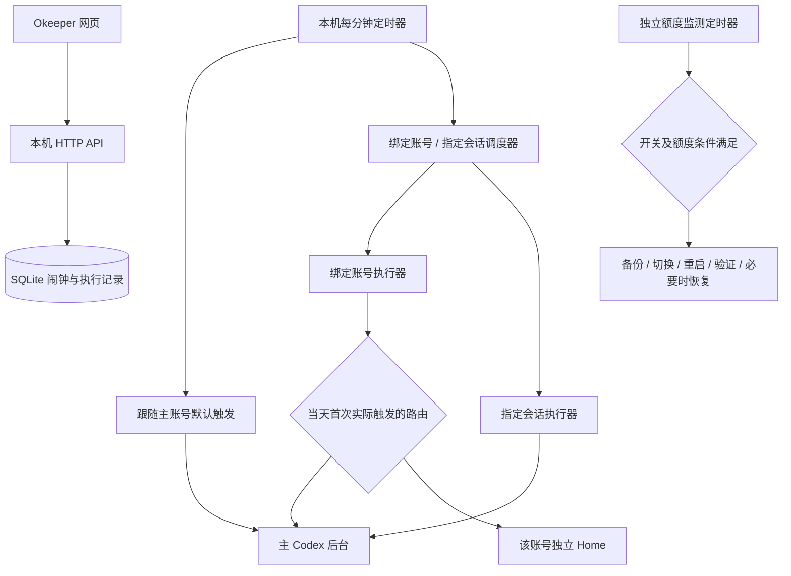

# Okeeper 交付文档

## 1. 交付目标与设计取舍

Okeeper 把“何时给 Codex 发消息”和“Codex 如何执行任务”分开。网页负责设置时间、目标与提示词；常开服务器负责按时投递和观察结果；模型实际执行仍由本机 Codex app-server 完成。

最初需求是让一次很轻的实际推理尽量贴合工作节奏，从而影响账号五小时用量窗口的起点。Okeeper 负责准时发起真实一轮处理，不把进入队列或连接成功当成执行完成。额度规则由服务提供方决定，Okeeper 不修改额度，也不能保证一次请求一定改变重置时间。

关键取舍：

1. **本机调度**：网页关闭、SSH 断开仍由用户级 systemd 触发，不使用云端计划任务。
2. **错过就跳过**：晚于约定时点 15 秒不发，不在恢复联网后集中补发。
3. **先记录再发送**：以持久化的时点与目标去重；状态不确定时不自动重发，避免额外消息。
4. **默认路径保持轻量**：固定 `gpt-6-luna`、`low`（界面 Light）、正文 `ok`；不开放模型和强度选择。
5. **自定义会话单独执行**：可填写提示词，沿用目标会话设置；长任务不会因调度器的短超时被主动停止。
6. **源码与私密运行状态分离**：GitHub 只保存实现、部署模板、文档和可复现测试。

## 2. 用户能做什么

| 区域 | 行为 |
| --- | --- |
| 标题与时钟 | 展示下一次发送，统一 Asia/Taipei、24 小时制；右上角直达 GitHub 仓库页 |
| 累计触发统计 | 实时统计 `6 Luna Light · ok` 累计触发次数与真实消耗 Token，打开页面自动回放当日累计增量动效 |
| 账号额度与专属队列 | 每个账号独立展示短期/每周额度进度、重置时点及专属触发队列，按最近一次触发顺序排列并标注跨日 `+1` |
| 账号操作与快捷对齐 | 手动切换账号并重启、重启后台按钮；队列支持一键 **⚡ 对齐重置点** 与卡片 **＋ 顺延下一轮** |
| 自动切换开关 | 默认关闭，开启后在短期额度用尽且另有可用账号时切换并重启 |
| 定向会话发送 | 底部独立专区，选择本机已有会话并填写多行提示词（带滚动条预览）；默认沿用会话设置，也可实时读取 `model/list` 强制指定模型与推理档位 |

时间滚轮支持触屏滑动、鼠标悬停滚轮和点击输入。编辑框打开后直接按 Enter 即保存；提示词中的 Enter 换行，Ctrl / ⌘ + Enter 保存。下一次触发卡片高亮，启停时使用 Motion 缩放动画，并尊重减少动态效果设置。

## 3. 目录和运行边界

```text
Okeeper/
├── app/                    Python 服务、调度、执行与持久化
│   ├── settings.py         路径及子进程环境配置
│   ├── web_server.py       HTTP 页面和 API
│   ├── schedule_store.py   闹钟、每日/一次、＋301 分钟
│   ├── trigger.py          跟随主账号的默认触发
│   ├── custom_*.py         指定会话调度 / 状态 / 执行
│   ├── account_*.py        账号路由、额度、切换和账号触发
│   ├── auth_profiles.py    原生账号副本发现与更新
│   ├── quota_watch.py      自动切换监测
│   ├── session_catalog.py  主后台跨项目会话目录
│   └── rpc.py              Codex app-server 通信
├── web/                    HTML / CSS / JavaScript，本地 vendor
├── deploy/systemd/         可迁移的服务与定时器模板
├── scripts/                服务安装及隔离测试入口
├── tests/                  Python 回归测试
│   └── browser/            离线浏览器回归与虚构数据服务
├── docs/HANDOVER.md         本交付文档
├── requirements.txt        Python 运行依赖
├── package*.json            浏览器测试依赖，不是前端构建要求
└── README.md                项目简介及快速启动
```

前端没有构建步骤，运行时不请求 CDN。Python 直接使用标准库 HTTP 服务和 SQLite，额外运行依赖为 `websockets`。Node 和 Playwright 仅用于开发测试。

已有部署的运行状态继续保存在 `~/.local/state/codex-local-trigger`。保留这个历史目录名是为了维持账号独立 Home、会话路径和执行去重记录，不代表源码仍在旧路径。原始 Codex 登录及会话仍由 `~/.codex` 管理。

## 4. 调度与执行路径



### 4.1 默认跟随主账号

`okeeper-default.timer` 每分钟唤醒 `trigger.py daily`，仅在启用闹钟的准确分钟处理。时点键为 `daily-v2:<scheduled_iso>`，同时使用本机锁。

当天第一次实际触发时新建轻量会话，随后复用；第一次可以是中午或晚上，不要求早上必须创建。发送前核对会话为空闲、模型与强度符合固定值、任务仍然有效、尚未超过迟到阈值。

原路径保留首次实测门槛：状态目录需要存在 `daily-chat-test-passed.json` 才允许每日跟随主账号触发。迁移旧部署必须保留此文件；新部署需完成第 9 节的单次实测，不能手工伪造通过标记。

### 4.2 绑定账号的默认触发

`okeeper-dispatch.timer` 驱动 `account_dispatch.py`，每个账号使用独立执行服务和锁。时点键为 `account-v1:<account_id>:<scheduled_iso>`。

每次触发时，根据**实际运行的主后台账号**选路：匹配则使用主后台，否则使用 `account-homes/<account_id>` 中的独立 Home，以内存方式登录，固定轻量模型。独立路径不会为了投递消息而改写主账号或重启主后台。

默认轻量触发的 15 秒窗口只约束发送前准备，在 `turn/start` 前再做一次检查；收到提交回执后，即使 `turn/started` 晚于 15 秒，也只记录延迟并继续观察。完成观察保留 180 秒上限，账号执行服务保留 300 秒上限。每 5 秒以及完成通知、等待超时或连接断开时，按原 thread ID 和 turn ID 核对历史；只有该轮已完成，且历史中同时包含原始 `ok` 用户消息及最终回复，才记为完成，不再强制要求每条实时通知都收到。执行失败、中断、额度不足和结果不确定均不重发。独立后台在观察结束后关闭，观察超时仍无结果时记录明确的超时原因及关闭事件；它不保证超时后的执行继续。领取、准备完成、开始发送、接受请求、执行开始、历史完成核验和独立后台关闭分别记录事件，账号执行器错误只记录安全分类，不输出上游凭据或原始错误文本。近期请求展示这些固定分类的具体原因，不改写旧回执。

2026-11-10 修复验收：232 项后端测试和七组隔离浏览器回归通过，覆盖主/独立路径第 13 秒提交、第 16 秒启动仍完成，以及通知缺失、历史延迟、响应不确定不重发等情况。独立测试账号 22:43 的新建一次性定时验收于 22:43:13 完成，原始会话确认用户消息、最终回复均为 `ok`，同轮持久化完成事件及网页回执一致。验收闹钟已移除，执行回执保留；原闹钟、历史回执和主登录文件未改变，19:30 失败任务未补发。此次真实验收启动未超过 15 秒，跨界场景由隔离回归覆盖。证据保存于 `artifacts/trigger-late-start-fix-20261110/verification.json`。

**会话按账号、日期、所在端分别登记，不固定全天路径。** A 与 B 在主后台使用各自的触发会话；各账号的独立 Home 也使用自己的会话。当天同端复用、跨天首次触发新建；两个账号按需最多使用四个每日会话。切号后在下次触发重新选路，不搬移会话 ID。准备过程中发现主后台账号改变，且尚未提交任何 turn 时，可以改用独立 Home；一旦开始提交，失败或结果不确定都不跨端重发。`account_daily_one_chat` 旧唯一索引迁移时移除，原登记保留，主键 `(account_id,day,route)` 继续防重复创建。

清理在发送之后执行：主后台清理所有账号登记过的旧日触发会话，独立 Home 只清理其所属账号；也会按需连接另一端清理。今天和未来日期的会话、普通用户会话不删除，忙碌或失败的旧会话保留待下次重试。历史版本单次手动触发创建的旧会话按 `account_runs` 精确 ID 一并清理，保留执行回执，并通过 `account_chat_deletions` 记下已经删除的会话，避免反复处理。

本轮选路变更通过 151 项后端测试和五组隔离浏览器回归，包括同日主后台→独立 Home→主后台复用、账号分别建会话、跨天两端换新、旧索引无损迁移、提交响应不确定时不跨端重发，以及忙碌/失败清理延期。正式服务已加载新登记结构，原闹钟和会话登记保留；本轮未执行真实账号跨端推理与删除测试会话的验收。

### 4.3 指定已有会话

`custom_dispatch.py` 为每个目标启动独立服务，时点键为 `thread-v1:<thread_id>:<scheduled_iso>`。不同会话可以同时触发；同一目标同一时刻不可重复。一次任务在执行前停用。

目录包含主后台所有项目的普通及已归档会话；显示名称及完整 ID。受管理的默认触发会话不可选。归档目标可恢复后投递；目标已删除、不可访问或忙碌时，失败或跳过，不另建替代会话。任务编辑后的 revision 会使旧执行记录失效。

定向任务可选择执行账号，默认跟随执行时的主后台账号。绑定 B 而当前主后台是 A 时，由 `custom_account.py` 在共享账号操作锁内检查目标及全部已加载会话空闲，结合其他 Okeeper 已提交请求回执检查，然后复用原生账号切换与失败恢复流程。停止前再次检查任务有效、账号启用、后台空闲；切换后通过 `account/read` 核对工作区和邮箱，才向原 `threadId` 投递。成功后主后台保留 B，不自动切回 A。锁持有到收到投递回执，观察长任务时释放。

后台忙碌、状态无法核实、目标账号停用或缺少原生登录副本、切换失败时跳过，不改用其他账号或独立 Home。同一会话同一时点即使账号不同也不能重复配置。领取前仍使用 15 秒迟到限制；实际发生账号切换时，停止、启动和核验可使用最长 180 秒的总投递准备窗口，超过后不再发送。这个窗口不限制已提交任务的执行时长。保存、编辑、启停与删除撤销保留所选账号；切号进度和未发送原因显示在任务卡片与近期请求中。

发送前读取目标最新模型和推理强度；`thread/resume` 不覆盖会话设置。未指定本次模型时，`turn/start` 沿用会话设置；明确指定时仅覆盖本次选择的模型和档位，保留工作目录、权限或开发者指令。需要沿用的设置确实缺失或正在变化时不发送，不能偷偷降级到默认模型。原生 `reasoningEffort: null` 合法，代表未显式设置档位，应保留原生默认而非判为缺失；任务已经明确指定模型及档位时，不依赖原会话提供这些值。

自定义任务没有旧的三分钟运行上限；若需要人工确认，记录等待状态，不自动批准。观察连接断开后继续核验同一个 turn，不重发提示词。主后台重启仍可能中断任务，长任务独立执行不等于能够抵抗主后台重启。

账号选择功能验收：196 项后端测试与七组隔离浏览器回归通过。临时原生 Home、模拟后台覆盖 A→B 切换后原会话投递、身份复核、失败恢复、忙碌与审批等待跳过、停止前状态复核、15/180 秒时限、响应丢失不重发、并发同账号提交及账号选择的保存/编辑/启停/撤销。正式网页服务已更新，只读核对两个可选账号及 1280/390/320px 显示，原闹钟配置和主登录哈希不变。未执行真实 A→B 切换发送，避免重启当前使用中的 Codex 后台。

2026-10-24 05:34 现场测试补充：切换到指定账号已成功，随后被旧的“模型与档位必须非空”检查拦住，尚未调用 `turn/start`。已修正原生空档位和明确覆盖设置的处理，增加切号后空会话指定模型/low 的回归；该类发送前错误显示为具体“未发送”原因。旧回执保留，读取历史时只对已知错误且没有 turn ID 的记录解释为未发送，不自动补发、不改写原记录。

修正验收：201 项后端测试和近期请求浏览器回归通过；本机生成的原生协议确认 `ThreadResumeResponse.reasoningEffort` 可为 null。现场目标会话在不投递消息的情况下通过修正后的准备检查，正式页面已能显示该次具体原因，旧回执、闹钟和主登录哈希保持不变。本轮未重发原任务或再次切换真实账号。

### 4.4 一次任务、快捷新增与历史清理

一次任务保存绝对的 `run_at`；错过后停用，不滚动到次日。删掉全部闹钟后保持空列表，不重新填入最初三个默认时间。

“＋5小时01分”在服务端读取原卡片：每日模式按 24 小时循环；一次模式在原绝对日期上加 301 分钟，即使跨午夜也保留正确日期。结果已过期时拒绝新增。原卡片不变，新卡片默认开启且可独立编辑。重复目标 / 时间和混用跟随主账号 / 绑定账号的歧义仍按原规则拦截。

历史会话只清理调度器登记过的旧日期会话。空闲时先 `thread/archive`，再 `thread/delete` 永久删除；忙碌或失败则保留记录稍后再清理，不按标题批量删除普通用户会话。清理在时效性投递之后执行，避免拖延消息。

### 4.5 手动发送与队列即时排序

账号队列中的“立即发送”通过 `POST /api/accounts/<id>/trigger` 提交 UUID 请求 ID。先在 `account_runs` 持久化回执，再复用账号独立执行器；同一请求重试只读原回执。同一账号已有正在执行的轻量任务时拒绝新请求，执行器仍使用账号锁并核验实际身份。

手动任务的 `alarm_id` 为空，以 `account-manual-v1:` 标识，不创建、修改或消耗闹钟。与定时触发一样按当前身份选择主后台或隔离 Home，复用该账号、该端当天的轻量触发会话，不再每次点击新建。正文、模型和强度沿用轻量 `ok` 设置，完成须通过既有事件和同一会话历史核验；没有提供强制重置额度的接口。主后台上的手动会话也排除在定向发送候选之外。

页面在执行中每两秒刷新回执，完成后请求刷新额度；连接断开时保留原请求 ID，避免重复发送。执行器最长 300 秒，超过 315 秒仍无回执的手动任务显示结果未确认，不自动补发。

一次闹钟被领取或错过后，在下一次状态刷新时立即排到队尾，不再保留旧的 60 秒宽限；每日闹钟依据服务器校准时间每秒更新排序和跨日标记，不复用已过期的 `next_at`。卡片节点保留，开关交互与既有动画继续有效。

新增 `tests/test_manual_trigger.py` 和 `tests/browser/manual-trigger-check.cjs` 覆盖请求防重、账号隔离、旧路径不受影响、断线恢复、05:26 当分钟退到 15:17 后方、每日到点无轮询重排与手机布局。浏览器发送使用隔离模拟执行器，不代表真实推理或额度窗口已经重置。

## 5. 额度与账号切换

### 5.1 发现与额度读取

账号来自原生 `auth.json`、`auth-profiles` 以及 CC Switch 的本地账号数据，按工作区和用户身份合并去重。邮箱完整显示，公开 API 只返回不可逆的账号标识，不返回登录令牌。

额度读取参考 CC Switch 的 WHAM usage 协议，必要时从主后台读取额度。页面使用缓存并标记旧数据和更新失败；实际额度与重置时点来自账号服务，不通过本地推测五小时窗口。令牌刷新在本机串行化并更新完整一致的凭据代际；原生登录文件与 CC Switch 的存储格式不能直接互换。

### 5.2 手动切换 / 重启

切换流程为：核验目标原生凭据 → 停止主后台 → 备份停止后的最新登录文件 → 激活目标凭据 → 启动 → 通过 RPC 核验实际账号 → 保存长期副本。

停止失败时不修改登录文件；激活或验证失败后尝试恢复原账号。账号操作有共享锁、持久请求 ID 和独立回执，浏览器重复点击不能重复重启。执行服务独立于将被重启的主后台，使用 `KillMode=process`，避免控制服务退出时连带杀掉新后台。

普通入口启动的主后台兼容：优先调用原生 daemon stop；仅在明确返回 `not managed by codex app-server daemon` 时，使用 `owned_runtime.py` 核对当前 Home 的真实 RPC Unix socket 对端 PID/UID、可执行文件及 app-server 命令，再通过 pidfd 向该精确进程发送 SIGTERM。身份或启动时间变化、非本用户、入口不符、代理进程、内核不支持核验等情况均拒绝停止；超时不升级强杀。停止后检测到客户端启动了替代进程则终止切号，保留登录文件，不追杀新进程。`unmanaged_runtime` 表示未托管，不能仅凭此认定安装入口冲突；旧失败回执仅在展示时修正文案，不改写历史。

兼容修正验收：210 项后端测试通过，使用真实隔离 Unix listener 验证精确对端停止、其他进程不受影响、身份/UID/入口不符拒绝、超时不强杀、替代进程保留及不支持 pidfd 时拒绝操作。正式后台的 socket 对端、启动时间、可执行文件与内核 pidfd 已只读核验，网页服务已更新，主后台 PID 和登录哈希不变。未停止或切换当前真实后台，实际切号仍需后续用户操作验收。

切换后可能需要重新连接桌面或 SSH。必须有可用的原生登录副本才提供切换，不能把任意路径、命令或凭据交给网页执行。

### 5.3 自动切换开关

新安装默认关闭，设置保存在本机。开启后 `okeeper-quota-watch.timer` 每分钟检查，网页不必打开：

1. 确认实际运行的主后台账号，并读取新鲜额度。
2. 只在五小时窗口明确用尽且重置时点未到时考虑切换；仅每周额度用尽不会触发此规则。
3. 候选需有原生登录副本、五小时余额大于零，且返回的其他额度窗口也有余额；优先五小时余额最多者。
4. 不使用报错、过期或身份不明的数据。操作忙碌时跳过，不排队。
5. 在共享账号操作锁内再次核验开关、账号和额度，然后复用手动切换流程。
6. 同一次开关授权、当前账号窗口及目标账号只尝试一次；重启完成后至少冷却两分钟。失败目标不会每分钟反复重启。

关闭阻止尚未开始的自动切换；已经进入停止 / 恢复阶段的操作会完成收尾。关闭后再开启形成新授权周期，可重新尝试。监测不重新启用过去取消过的“已有五小时窗口就跳过定时消息”规则。

### 5.4 自动切号后继续任务

“切号后继续任务”对应 `quota-watch-config.json` 的 `continue_tasks`，默认关闭；旧配置迁移时保持原自动切换开关不变。两个字段可分别 PATCH，修改任一字段形成新 generation。只有自动切换开启时此选项才会实际生效；手动切号和普通重启不自动发消息。

启用后，在停止原后台之前，通过原账号身份核验、最近更新的会话目录和已加载列表收集候选：最近五分钟内最新一轮明确报 `usageLimitExceeded` 的普通根会话，以及切号前仍在执行、没有等待输入/审批标记的根会话。排除受管理的轻量触发会话、子代理、归档、临时会话和其他模型提供方。扫描限首批 100 条目录记录及已加载会话，设时间预算；部分无法读取时明确记录 `incomplete`，不推定其可续跑。

目标账号启动和身份核验成功后，仍在账号控制锁内重新检查开关 generation、目标账号、会话可用性和源 turn ID。源轮次必须仍是额度失败，或是此前捕获的活动轮次在重启后变为 interrupted。已完成、有新轮次、仍在忙碌或等待输入的会话跳过；关闭开关阻止尚未提交的续跑。中断确认可能早于 idle 状态，最多等五秒，不主动打断任何会话。

仅调用 `thread/resume` 和向同一 `threadId` 的 `turn/start`，消息固定为 `continue`，不覆盖模型、推理强度、目录、指令和权限，也不自动批准工具。投递前持久化 `account-continue-receipts/<hash>.json`，键来自源会话和源 turn ID；响应丢失记为未确认，不自动重发。回执 `accepted` 和页面“已提交续跑”只表示服务器接受消息，不表示任务完成或新账号支持所有原模型。续跑失败不会回滚已经核验成功的账号切换。

自动切号仍由每分钟的额度监测触发，不是额度错误发生时立即切号。候选只覆盖当次扫描可核验的会话，不恢复历史任意失败任务。

本功能回归：143 项后端测试与五组隔离浏览器检查通过。独立真实会话中等待 `turn/started` 后中断，使用本模块在同一会话投递 `continue`，提交连接关闭后仍完成；同一源轮次再次请求没有重发，模型与强度保持一致，临时会话已删除。该实测未切换真实账号，也未制造真实额度耗尽，因此不把它当作额度耗尽到另一账号续跑的现场整链验收。

## 6. 配置与数据

### 网页账号管理与新建目标会话

账号面板“账号管理”提供官方设备码登录与停用/重新启用。登录由 `account_management.LoginManager` 在临时独立 `CODEX_HOME` 中启动 `codex_stdio.NativeClient`，展示 OpenAI 官方设备授权网址与一次性登录码；授权完成后核对账号类型、邮箱和可用的工作区字段，原子保存为原生 `auth-profiles` 副本，不覆盖主 `auth.json`、不切号、不触发推理。取消、过期、失败会关闭子进程并清理临时目录；浏览器关闭弹窗不会取消正在进行的授权，再次打开可继续查看。重启网页服务会结束尚未完成的登录，需重新生成登录码。

网页登录授权过的账号在 `account-authorizations.json` 登记，明确优先于 CC Switch 中同身份的旧副本；轮换令牌在本机共享锁内更新。原生账号凭据到期后，由临时独立 Codex 进程执行原生 `account/read` 续期，身份核验后更新副本，避免要求用户必须安装 CC Switch。公开接口不返回访问令牌、刷新令牌或原始登录文件。

停用状态存于 `account-preferences.json`，不会删除凭据或修改闹钟。首页额度与绑定闹钟、账号选择器、触发分发及自动切号候选排除停用账号，尚未提交的绑定任务会复核停用状态。当前主账号停用时，跟随主账号与定向任务的新投递也暂停，已提交任务不强行中断，主 Codex 登录和普通手动使用不受影响；可在账号管理重新启用。重新启用不补发错过的闹钟。请求历史仍保留原始执行记录。

会话选择弹窗的“新建会话”只保存工作目录和可选名称，点击“使用此配置”不调用 Codex，也不创建空会话。保存任务后，`alarms.new_session` 保留 `{cwd,name}`，内部 thread_id 在此模式只作为配置防重标识，页面显示“到点新建”。默认目录范围为 `OKEEPER_WORKDIR`，可通过 `OKEEPER_WORKSPACE_ROOTS` 扩展；隐藏目录、越界路径与指向范围外的符号链接不可选。到点领取唯一 `new-thread-v1` 回执后，先核验/切换账号，再重新核验目录，在同一个 RPC 连接调用 `thread/start` 并立即 `turn/start`；首次投递后设置名称。创建或发送结果不确定均不重试。每天模式每次创建新会话，已有会话模式仍复用指定会话。原 `POST /api/sessions` 保留兼容，网页新建流程不再调用它。

到点新建验收：216 项后端测试、七组隔离浏览器回归通过，覆盖配置持久保存与重启后读取、编辑/撤销保留目录与名称、无提前创建、切号后按指定目录/模型创建和同连接首次投递、结果不确定不重建、迟到不创建及切回已有会话。正式网页已更新，原闹钟和主登录保留；页面只读试选配置没有发送任何修改请求。未在正式后台新建会话或触发推理。历史已失败的旧会话任务不会自动改写或补发，需要编辑为新配置并重新设置时间。

新增接口：`GET /api/account-management`、`PATCH /api/account-management/<id>`、`GET/POST/DELETE /api/account-login`、`GET /api/workspaces?path=…`、`POST /api/sessions`。修改接口沿用同源 JSON 和应用请求头检查。该功能沿用现有受信任本机/私网访问边界，不提供公网用户鉴权。

本轮新增隔离测试覆盖授权身份核对、真实 stdio 协议的假 Codex 子进程、取消清理、原登录不变、停用持久化与任务排除、原生副本续期、工作目录边界、新建请求防重及名称失败回执。浏览器覆盖账号管理、设备码与取消、停用/恢复和错误回滚、手机布局、文件夹选择、新建空目标及后续定向任务保存；模拟授权不等于真人完成官方登录。

验收结果：180 项后端测试和七组浏览器回归通过。真实官方设备码已在独立临时环境成功申请并取消，原主后台登录哈希不变；真人授权完成尚需用户操作。正式服务已更新，只读核对三个账号、文件夹列表、320/390px 布局和新建入口，原闹钟配置保留。本轮未用真实账号创建额外会话或发起推理。

| 配置 | 默认 / 含义 |
| --- | --- |
| `OKEEPER_BIND` | `127.0.0.1`，网页监听地址 |
| `OKEEPER_PORT` | `18793` |
| `OKEEPER_STATE_DIR` | `~/.local/state/codex-local-trigger`，兼容历史部署 |
| `OKEEPER_CODEX_HOME` | `~/.codex`，主账号原生 Home |
| `OKEEPER_CODEX_BIN` | PATH 中的 codex，否则 `~/.local/bin/codex` |
| `OKEEPER_CODEX_SOCKET` | 主 Home 下 `app-server-control/app-server-control.sock` |
| `OKEEPER_WORKDIR` | 用户 home，默认轻量会话工作目录 |
| `OKEEPER_WORKSPACE_ROOTS` | 新建会话的文件夹选择根目录，默认 `OKEEPER_WORKDIR`；多项以系统路径分隔符分隔 |
| `TMPDIR` | 本机临时目录，建议设为用户自己的 `~/tmp` |

历史 `RHYTHM_STATE_DIR`、`RHYTHM_BIND`、`RHYTHM_PORT` 仍兼容，新前缀优先。主服务读取可选的 `~/.config/okeeper/env`；派生执行器只传递白名单配置，不通过 systemd 参数传令牌。

状态目录中的核心数据：

- `runs.sqlite`：`alarms`、`alarm_settings`、默认 `runs/daily_chats`、`custom_runs`、`account_runs/account_daily_chats`。
- `events.jsonl`：执行事件；包含目标、时点和结果，属于私密运行数据。
- `account-homes/`：绑定账号隔离的会话与执行环境。
- `quota-access.json`：私密访问令牌缓存，权限 0600，不入 Git。
- `account-control.json` 与 `account-control-receipts/`：最近操作及防重回执。
- `quota-watch-config.json`、`quota-watch-result.json`：开关与监测结果。
- `account-preferences.json`、`account-authorizations.json`：停用账号和网页授权凭据归属登记。
- `session-create-receipts/`：新建目标会话请求与结果，防止未知回执导致重复创建。
- `account-continue-receipts/`：切号后继续任务的源轮次、防重复投递状态和新 turn ID；不保存原提示词与令牌。
- `GET /api/requests`：只读合并三类数据库回执与 continue 回执，最多返回最近 100 条；不连接会话后台、不补发、不修改原回执。历史 continue 可从对应的切号操作回执恢复账号归属；其他缺失字段显示未记录，不使用当前账号倒推。新默认/定向记录在发送前快照账号名称，定向记录领取时快照会话标题；continue 在持久化发送回执时快照目标账号。
- `daily-chat-test-passed.json`：历史默认触发的实际验收门槛。

网页仅面向受信任的本机 / 私有网络，没有面向公网的用户认证。修改 API 要求同源 JSON 和应用请求头。源码、数据库、凭据和日志有明确边界，但这不替代公网部署所需的鉴权。

## 7. 安装、迁移与维护

先完成 README 中的 Python 依赖安装，再安装用户级服务：

```sh
.venv/bin/python scripts/install_services.py --bind <服务器私网IP> --start
```

`--python` 可指定已有 Python 环境。模板根据当前源码位置生成绝对路径，移动目录后需要重新运行安装器。迁移历史 Rhythm 部署时加 `--migrate-legacy`，防止两套定时器同时发送。

启用的服务：

| 单元 | 职责 |
| --- | --- |
| `okeeper-web.service` | 网页和 API，异常退出自动恢复 |
| `okeeper-default.timer/.service` | 跟随主账号默认触发 |
| `okeeper-dispatch.timer/.service` | 绑定账号和指定会话分发 |
| `okeeper-quota-watch.timer/.service` | 读取已保存开关，监测额度 |
| `okeeper-task-*` | 指定会话长任务，无运行时限 |
| `okeeper-account-*` | 绑定账号轻量执行 |
| `okeeper-control-*` | 手动切换和重启 |

三个 timer 使用 `Asia/Taipei`、每分钟、`AccuracySec=1s`、`Persistent=false`。用户退出登录后仍需运行时，检查系统是否为该用户开启 linger。

本次源码迁移到用户 home 下的 `Okeeper/`，停服后进行，运行状态留在原位置。旧源代码与旧单元的回滚包仅保留在私密状态目录的 `migrations/`，不上传。历史截图、私人验收记录、重复备份及过时的单次测试脚本不留在源码仓库。

常用维护：

```sh
systemctl --user status okeeper-web.service okeeper-default.timer okeeper-dispatch.timer okeeper-quota-watch.timer
journalctl --user -u okeeper-quota-watch.service -n 50
systemctl --user stop okeeper-web.service okeeper-default.timer okeeper-dispatch.timer okeeper-quota-watch.timer
```

需要完整迁移机器时，应先停服，再备份私密状态、主 Codex Home 和账号副本，并校正隔离 Home 中可能记录的绝对路径。仅从 GitHub 克隆源码不会带回任务、登录状态或历史会话。

## 8. 故障处理

- **页面可开、没有发送**：检查定时器、闹钟是否启用、一次任务日期、实际后台可访问性，以及默认路径的实测门槛文件；查看执行状态。不要通过删除去重记录强行重放。
- **显示 accepted / running**：这表示已经提交 / 启动，不代表完成。完成需要事件和同一会话中持久化历史的证据。
- **额度更新失败**：保留当前账号；检查本机登录和 CC Switch 凭据，不能用旧的 0% 触发自动切换。
- **未能停止主后台**：登录文件保持原状。检查 CLI 实际安装入口和进程登记是否一致，不使用全局 `pkill`。
- **安装入口冲突**：原生 daemon 的独立包 `current` 和 standalone 入口可能对应不同 PID 登记。只核验本机实际布局后修复，不在隔离测试中共享可写的 packages/current。
- **切换失败且恢复未确认**：保留回执，通过 SSH 检查实际后台与登录文件后再人工处理；不要循环自动重试。
- **历史触发会话仍显示**：核对登记 ID 与后台完整列表，确认 archive 后执行 thread/delete；不能仅删 rollout 文件冒充完整删除。

## 9. 验收与后续接手

Python 测试覆盖闹钟持久化、跨日、重复与迟到跳过、会话清理、设置继承、每次账号选路与按端每日复用、额度新鲜度、切换前复核、防重复和失败恢复。

浏览器测试仅连接临时本机服务，使用虚构账号与会话，覆盖：额度开关保存 / 错误恢复、＋301 分钟与撤销、指定会话及多行提示词、Enter 保存、卡片动画与减少动态效果、手机布局。

```sh
python3 scripts/test.py
npm ci
OKEEPER_PYTHON=<有运行依赖的Python> OKEEPER_BROWSER=<本机Chrome路径> npm test
```

新安装的真实投递验收需要用户授权的测试账号与会话。在状态目录写入 `test-schedule.json`，内容为 `{"scheduled":"未来的台北时区ISO时间"}`，由一次性本机 systemd 定时器在该时点执行 `app/trigger.py test`。观察 `turn/started`、用户消息、最终回复、`turn/completed`，再回读同一 thread 的持久化历史；测试会生成门槛文件。测试结束后按具体 ID 先归档再删除测试会话，并删除测试单元。该步骤会进行真实推理，不属于离线回归。

本次迁移的 114 项 Python 测试及 4 组离线浏览器回归全部通过；正式网页的 Okeeper 品牌、手机布局、任务数据与自动切换设置连续性已检查，四个常驻入口均已恢复。

历史部署已完成过同一会话的真实定时投递、日内复用以及隔离账号切换验收。本次迁移以代码回归、离线浏览器交互、正式服务路径与状态连续性检查验收；不把离线测试当成新一次真实定时投递或额度重置证据。

后续修改应先保留这些约束：固定默认模型与正文；既有会话继承设置；不补发、不重复；每次发送前核验账号、提交后不跨端重发；只清理登记的触发会话；自动切换使用实际后台身份且不因错误数据重启。
